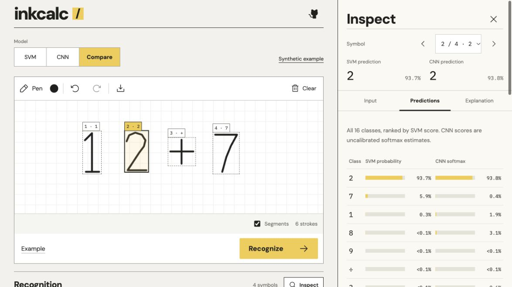

# InkCalc

A handwriting-recognition project comparing a calibrated HOG + SVM with a CNN.
Python handles preprocessing, segmentation, classification and arithmetic. A small
React interface provides a drawing canvas and visual inspection of the models.



## Development

Requires Python 3.12, Node.js 24+, and [uv](https://docs.astral.sh/uv/).

```sh
uv sync --locked
uv run uvicorn inkcalc.api:app --reload --host 127.0.0.1 --port 8000
```

In a second terminal:

```sh
cd frontend
npm ci
npm run dev
```

Open the Vite URL. Its `/api` proxy connects to the local Python service.

Both trained models are included, so normal startup needs no dataset download.
Recognition and calculation run on your computer. History is stored in your browser;
drawings are not persisted. No external OCR or hosted AI service is called.

## What it does

- Draw with a mouse, finger or pen; undo/redo drawing actions and export as PNG.
- Recognize digits and + − × ÷ ( ), with symbol previews and alternative predictions.
- Choose the calibrated HOG + SVM, the original PyTorch CNN, or Compare mode.
- Compare per-symbol predictions and all 16 scores, inspect disagreements, choose
  the expression source explicitly, and view both models' sensitivity maps together.
- Inspect each detected region: original crop, normalized 28 × 28 pixels, all 16
  class scores, and a signed occlusion sensitivity map.
- Select numbered regions on the drawing, or hide Segments to draw over them.
- Correct a prediction or type an expression directly; decimal commas are accepted.
- Evaluate parentheses, operator precedence and negative numbers with visible steps.
- Keep the latest 20 calculations locally, with a clear-history action.
- Use the workspace on desktop and mobile, including a keyboard-only calculation path.

The interface follows generated desktop and mobile references, then translates
them into real controls: a square-grid notebook, compact symbol review, a prominent
result and a flat history list. Fonts are served locally. See the
[visual direction and reference analysis](docs/design/art-direction.md).

Keyboard shortcuts: Ctrl/⌘ Z to undo, Ctrl/⌘ Shift Z to redo, and Enter in the expression
field to calculate. Escape closes inspection or symbol correction. History entries can be reopened without creating
a duplicate calculation.

## Inspect recognition

Recognize a drawing, then choose **Inspect** or click a numbered detection box.
Use the Symbol selector to switch between detected characters.

At desktop widths (1,100 px and above), Inspect opens in a dock beside the drawing.
The drawing remains interactive and the details scroll independently. On smaller
screens, the same inspector opens in a modal bottom panel with a backdrop, focus
containment and scroll locking. Use the previous/next buttons or the Symbol selector
to move through the drawing. Closing restores focus to the opening control.

If you edit the drawing while inspecting on desktop, the dock stays in place and
asks you to recognize again. This keeps the canvas width stable under the pen and
discards outdated predictions and explanations. Resizing preserves the selected
symbol and active tab. Base UI provides Dialog and Tabs behavior; the existing CSS
defines the appearance.

- **Input** shows the raster crop, its dimensions, and the normalized 28 × 28 input.
- **Predictions** shows all 16 class scores in descending order: calibrated
  probabilities for the SVM, uncalibrated softmax scores for the CNN.
- **Explanation** calculates sensitivity on demand using 576 overlapping 5 × 5
  zero masks. Yellow means masking lowered the original prediction score; hatching
  means it raised the score. Values use percentage points and colors are scaled
  independently for each symbol.

Manual expression corrections do not rewrite the original model prediction or its
explanation. Tiny decimal marks use a size rule and have no classifier probabilities
or sensitivity map. Explanations are cached only in the open inspector's memory;
closing it or changing the drawing discards that cache. Drawings are not persisted.

The tabs support arrow keys, Home and End. Escape closes the inspector. A failed
explanation request can be retried without redrawing.

Recognition is imperfect: leave space between symbols, write on one line, and check
the predictions before calculating. On the same 2,000 held-out MNIST digits, accuracy
is **95.65% for the SVM** and **96.65% for the CNN**. These are symbol-classification
results, not complete-expression accuracy. See `models/comparison.json` for recorded
results and matching training/evaluation input hashes.

## Compare SVM and CNN

Select **Compare**, draw or load an example, then choose **Recognize**. The table
shows each model's original prediction and flags disagreements. Select a symbol to
inspect the shared input, aligned class scores, or both explanation maps on a common
color scale. **Use CNN expression** or **Use SVM expression** selects the expression
to calculate; neither action rewrites the other model's predictions.

SVM probabilities are calibrated; CNN scores are uncalibrated softmax estimates.
Higher confidence alone does not identify the better model. The synthetic challenge
is an original example selected to explore disagreement, not an accuracy benchmark.
All predictions and maps are calculated by the actual committed models.

Both explanation maps stack inside the inspector and use one color scale. See the
[mobile inspection panel](docs/inspector-mobile-panel.png).

The CNN has two convolutional layers and 79,104 parameters, trained for eight fixed
epochs on the same 23,900 normalized training inputs as the SVM. Both weight files
are included. Retrain in order with:

```sh
uv run python scripts/train.py --digits 20000
uv run python scripts/train_cnn.py --digits 20000 --epochs 8
```

## Run the built application

```sh
uv sync --locked
npm --prefix frontend ci
npm --prefix frontend run build
uv run uvicorn inkcalc.api:app --host 127.0.0.1 --port 8000
```

Open <http://127.0.0.1:8000>. Build the frontend before starting this single-server
mode. The API documentation is available at <http://127.0.0.1:8000/docs>.

## Checks

```sh
uv run pytest -q
uv run ruff check src tests scripts
npm --prefix frontend test
npm --prefix frontend run build
```

GitHub Actions runs the backend and frontend checks independently on every push.
The backend tests cover arithmetic limits, bad API requests, stroke grouping and
real-model symbol classification, model availability, comparison and masking
explanations. Frontend tests cover corrupt or unavailable browser storage,
persistence, the history limit and switching the expression source without
changing the original predictions, modal focus containment, dismissal, keyboard
tabs and preserving inspection state across responsive breakpoints.

## Layout

```text
src/inkcalc/       Python API, arithmetic interpreter, preprocessing and recognition
frontend/src/     React workspace, pointer canvas and browser-local history
models/           SVM/CNN weights and generated evaluation metrics
scripts/          Shared training data and reproducible SVM/CNN training
tests/            Backend unit and API tests
docs/model.md     Data provenance, evaluation and limitations
```

See the two training commands above to regenerate both models and their comparison.
See [the model card](docs/model.md)
for data sources, checksums, evaluation protocol and limits. Model probabilities
are estimates, and manually corrected symbols are explicitly labelled as corrected.

## Inspiration

Inspired by [Youjia Zhang's MNIST handwriting calculator](https://github.com/YoujiaZhang/MNIST-Calculator-Handwriting-recognition).
InkCalc is an independent implementation: no notebook code, weights, images or
extended-symbol dataset are copied from that repository. See `docs/model.md` for
training data, evaluation and limitations.
