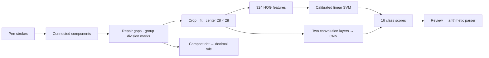
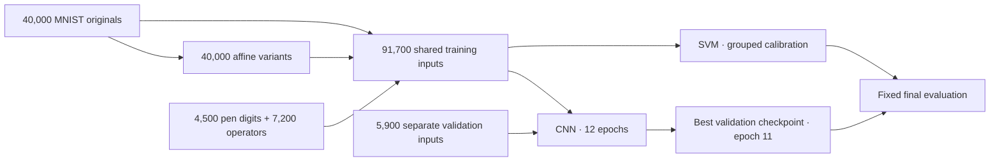

# MNIST Handwriting Calculator · SVM & CNN

Handwritten arithmetic using **MNIST digits**, generated operators, a calibrated
HOG + SVM and a small CNN. Draw, compare predictions, inspect each symbol, then
calculate. Python + React; models included. [MIT license](LICENSE).

## Recognition pipeline



| Stage | Method |
| --- | --- |
| Segmentation | Thin stroke components; endpoint direction repairs interrupted strokes; aligned dot–bar–dot groups become division. |
| Input | Antialiased raster, ink crop, 20 × 20 fit, center of mass on a 28 × 28 frame. |
| SVM | Local gradient directions → linear class boundaries → three-fold sigmoid calibration. Source variants stay in the same fold. |
| CNN | Two convolutions learn local features; pooling and a 64-unit layer produce 16 logits. 79,104 parameters. |
| Inspection | Same pixels for both models; all scores, segment boxes and signed 5 × 5 occlusion maps. |

Classes: `0–9 + - * / ( )`. A compact decimal mark uses geometry. CNN softmax
scores are uncalibrated; a higher score alone does not identify the better model.

## Before → after

Identical inputs, seed **90210** (now also used for regression tests). Before uses
[`benchmark-v1`](https://github.com/lelouchzr/MNIST-Handwriting-Calculator-SVM-CNN/tree/benchmark-v1).
All 16 classes remain eligible during isolated-symbol evaluation.

| Evaluation | Samples | SVM before → after | CNN before → after |
| --- | ---: | ---: | ---: |
| MNIST test digits | 10,000 | 96.82 → **97.37%** | 97.53 → **98.84%** |
| Procedural pen digits | 1,000 | 98.90 → **100.00%** | 98.40 → **100.00%** |
| Procedural operators | 1,200 | 99.67 → **99.83%** | 95.08 → **99.75%** |
| Exact expressions, procedural | 240 | 62.08 → **99.58%** | 58.75 → **100.00%** |

Segmentation requires the correct ordered symbol count and bounding-box IoU ≥ 0.5:

| Expression profile | Before | After |
| --- | ---: | ---: |
| Tight spacing | 0/40 | 40/40 |
| Decimal marks | 0/40 | 40/40 |
| Division / spaced / slanted | 120/120 | 120/120 |
| Interrupted strokes | 40/40 | 40/40 |
| **All** | **160/240 (66.67%)** | **240/240 (100.00%)** |

Interrupted junctions use endpoint contact. A continuous-coordinate guard also
prevents pixel rounding from fusing tightly spaced digits. Model weights and
isolated-symbol scores are unchanged.

| Latest validation against the previous release | Cases | Before fix → after fix |
| --- | ---: | ---: |
| Previous expression holdout: segmentation | 1,800 | 1,799 → **1,800** |
| New independent expression holdout: segmentation | 1,800 | 1,797 → **1,800** |
| New exact expressions, SVM / CNN | 1,800 | 1,783 / 1,794 → **1,786 / 1,797** |
| New pixel-gap geometry and connected-symbol controls | 800 | 777 → **800** |

No previously correct case was lost, and no expression gained character errors.
These successful segmentations do not imply perfect classification. Procedural
tests do **not** validate new human handwriting; touching characters and multiline
math remain unsupported.

Scores and input fingerprints: [compact results](benchmarks/results.json).
Optional full evaluations: [benchmark guide](benchmarks/README.md).
Data provenance and limits: [model card](docs/model.md).

## Training



```sh
uv run python scripts/train.py --digits 40000
uv run python scripts/train_cnn.py --digits 40000 --epochs 12
```

The small application suite runs with `uv run pytest -q`. Randomized corpora and
model comparisons run separately with `uv run pytest benchmarks -q` and
`uv run python -m benchmarks.pixel_gaps`. Detailed logs stay in `.cache/benchmarks/`.

Training downloads checksum-verified MNIST into ignored `.cache/`. Validation comes
from the training split; final evaluation never selects the CNN checkpoint.

## Run locally

Python 3.12, Node.js 24+ and [uv](https://docs.astral.sh/uv/):

```sh
uv sync --locked
npm --prefix frontend ci
npm --prefix frontend run build
uv run uvicorn inkcalc.api:app --host 127.0.0.1 --port 8000
```

Open <http://127.0.0.1:8000>. For frontend development, run `npm --prefix frontend run dev`
alongside the API. Recognition runs locally; drawings are not persisted.
