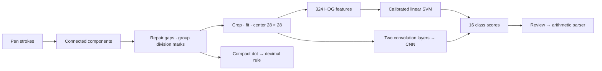
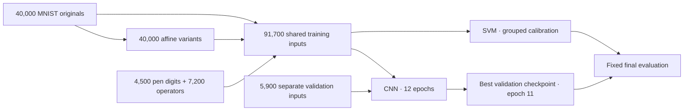

# InkCalc

Handwritten arithmetic with a calibrated HOG + SVM and a small CNN. Draw, compare
predictions, inspect each symbol, then calculate. Python + React; models included.

## Recognition pipeline



| Stage | Method |
| --- | --- |
| Segmentation | Thin stroke components; endpoint direction repairs interrupted strokes; aligned dot–bar–dot groups become division. |
| Input | Antialiased raster, ink crop, 20 × 20 fit, center of mass on a 28 × 28 frame. |
| SVM | Local gradient directions → linear class boundaries → three-fold sigmoid calibration. Source variants stay in the same fold. |
| CNN | Two convolutions learn local features; pooling and a 64-unit layer produce 16 logits. 79,104 parameters. |
| Inspection | Same pixels for both models; all scores, segment boxes and signed 5 × 5 occlusion maps. |

Classes: `0–9 + - * / ( )`. A compact decimal mark uses geometry. CNN softmax
scores are uncalibrated; a higher score alone does not identify the better model.

## Before → after

Identical final inputs, seed **90210**. Before uses revision
[`2007190`](https://github.com/lelouchzr/inkcalc/commit/200719072ee4fc0463abc31b89973fa0fb80c6b2).
All 16 classes remain eligible during isolated-symbol evaluation.

| Evaluation | Samples | SVM before → after | CNN before → after |
| --- | ---: | ---: | ---: |
| MNIST test digits | 10,000 | 96.82 → **97.37%** | 97.53 → **98.84%** |
| Procedural pen digits | 1,000 | 98.90 → **100.00%** | 98.40 → **100.00%** |
| Procedural operators | 1,200 | 99.67 → **99.83%** | 95.08 → **99.75%** |
| Exact expressions, procedural | 240 | 62.08 → **98.33%** | 58.75 → **98.75%** |

Segmentation requires the correct ordered symbol count and bounding-box IoU ≥ 0.5:

| Expression profile | Before | After |
| --- | ---: | ---: |
| Tight spacing | 0/40 | 40/40 |
| Decimal marks | 0/40 | 40/40 |
| Division / spaced / slanted | 120/120 | 120/120 |
| Interrupted strokes | 40/40 | 37/40 |
| **All** | **160/240 (66.67%)** | **237/240 (98.75%)** |

Three interrupted-stroke cases regress. Procedural tests share a generator family
with training and do **not** validate new human handwriting. MNIST is the held-out
human-digit benchmark. Touching characters and multiline math remain unsupported.

Raw cases, confusions and fingerprints: [before](models/algorithm_before.json),
[after](models/algorithm_after.json), [comparison](models/algorithm_comparison.json).
Data provenance and protocol: [model card](docs/model.md).

## Training



```sh
uv run python scripts/train.py --digits 40000
uv run python scripts/train_cnn.py --digits 40000 --epochs 12
uv run python scripts/benchmark.py --stage before
uv run python scripts/benchmark.py --stage after
```

Training downloads checksum-verified MNIST into ignored `.cache/`. Validation comes
from the training split; final evaluation never selects the CNN checkpoint.

## Run locally

Python 3.12, Node.js 24+ and [uv](https://docs.astral.sh/uv/):

```sh
uv sync --locked
npm --prefix frontend ci
npm --prefix frontend run build
uv run uvicorn inkcalc.api:app --host 127.0.0.1 --port 8000
```

Open <http://127.0.0.1:8000>. For frontend development, run `npm --prefix frontend run dev`
alongside the API. Recognition runs locally; drawings are not persisted.
