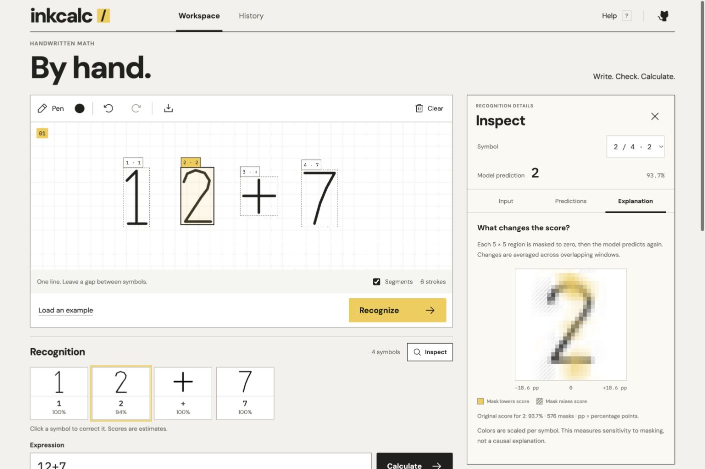

# InkCalc

A handwriting-first math workspace. Draw a single-line expression, inspect each
prediction, correct ambiguous symbols, and calculate without running arbitrary code.

Python handles image preparation, classification and arithmetic. React handles the
canvas, editable predictions and browser-local calculation history.



## Development

Requires Python 3.12, Node.js 24+, and [uv](https://docs.astral.sh/uv/).

```sh
uv sync --locked
uv run uvicorn inkcalc.api:app --reload --host 127.0.0.1 --port 8000
```

In a second terminal:

```sh
cd frontend
npm ci
npm run dev
```

Open the Vite URL. Its `/api` proxy connects to the local Python service.

The trained model is included, so normal startup needs no dataset download.
Recognition and calculation run on your computer. History is stored in your browser;
drawings are not persisted. No external OCR or hosted AI service is called.

## What it does

- Draw with a mouse, finger or pen; undo/redo drawing actions and export as PNG.
- Recognize digits and + − × ÷ ( ), with symbol previews and alternative predictions.
- Inspect each detected region: original crop, normalized 28 × 28 pixels, all 16
  class probabilities, and a signed occlusion sensitivity map.
- Select numbered regions on the drawing, or hide Segments to draw over them.
- Correct a prediction or type an expression directly; decimal commas are accepted.
- Evaluate parentheses, operator precedence and negative numbers with visible steps.
- Keep the latest 20 calculations locally, with a clear-history action.
- Use the workspace on desktop and mobile, including a keyboard-only calculation path.

The interface follows generated desktop and mobile references, then translates
them into real controls: a square-grid notebook, compact symbol review, a prominent
result and a flat history list. Fonts are served locally. See the
[visual direction and reference analysis](docs/design/art-direction.md).

Keyboard shortcuts: Ctrl/⌘ Z to undo, Ctrl/⌘ Shift Z to redo, Enter in the expression
field to calculate, and `?` outside editable fields to open help. Escape closes help
or the symbol correction controls. History entries can be reopened without creating
a duplicate calculation.

## Inspect recognition

Recognize a drawing, then choose **Inspect** or click a numbered detection box.
Use the Symbol selector to switch between detected characters.

- **Input** shows the raster crop, its dimensions, and the normalized 28 × 28 input.
- **Predictions** shows all 16 calibrated class probabilities in descending order.
- **Explanation** calculates sensitivity on demand using 576 overlapping 5 × 5
  zero masks. Yellow means masking lowered the original prediction score; hatching
  means it raised the score. Values use percentage points and colors are scaled
  independently for each symbol.

Manual expression corrections do not rewrite the original model prediction or its
explanation. Tiny decimal marks use a size rule and have no classifier probabilities
or sensitivity map. Explanations are cached only in the open inspector's memory;
closing it or changing the drawing discards that cache. Drawings are not persisted.

The tabs support arrow keys, Home and End. Escape closes the inspector. A failed
explanation request can be retried without redrawing.

Recognition is imperfect: leave space between symbols, write on one line, and check
the predictions before calculating. MNIST test-digit accuracy is **95.65% on 2,000
held-out samples**. This is not an end-to-end handwriting accuracy claim.

## Run the built application

```sh
uv sync --locked
npm --prefix frontend ci
npm --prefix frontend run build
uv run uvicorn inkcalc.api:app --host 127.0.0.1 --port 8000
```

Open <http://127.0.0.1:8000>. Build the frontend before starting this single-server
mode. The API documentation is available at <http://127.0.0.1:8000/docs>.

## Checks

```sh
uv run pytest -q
uv run ruff check src tests scripts
npm --prefix frontend test
npm --prefix frontend run build
```

GitHub Actions runs the backend and frontend checks independently on every push.
The backend tests cover arithmetic limits, bad API requests, stroke grouping and
real-model symbol classification. Frontend tests cover corrupt or unavailable
browser storage, persistence and the history limit.

## Layout

```text
src/inkcalc/       Python API, arithmetic interpreter, preprocessing and recognition
frontend/src/     React workspace, pointer canvas and browser-local history
models/           Trained model and generated evaluation metrics
scripts/train.py  Reproducible MNIST + original synthetic-operator training
tests/            Backend unit and API tests
docs/model.md     Data provenance, evaluation and limitations
```

Retrain with `uv run python scripts/train.py`. See [the model card](docs/model.md)
for data sources, checksums, evaluation protocol and limits. Model probabilities
are estimates, and manually corrected symbols are explicitly labelled as corrected.

## Inspiration

Inspired by [Youjia Zhang's MNIST handwriting calculator](https://github.com/YoujiaZhang/MNIST-Calculator-Handwriting-recognition).
InkCalc is an independent implementation: no notebook code, weights, images or
extended-symbol dataset are copied from that repository. See `docs/model.md` for
training data, evaluation and limitations.
